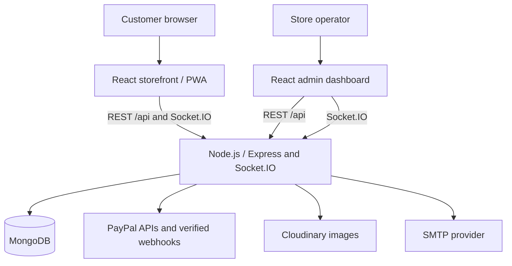

# NovaCart

**React storefront · React admin · Node.js/Express API · MongoDB · Socket.IO · Docker · Kubernetes · AWS EKS**

NovaCart is a full-stack e-commerce system for a consumer-electronics catalog. It includes a customer storefront, an operator dashboard, a REST and realtime API, PayPal checkout, and infrastructure-as-code. The product name is **NovaCart**. Older assets and reports may still say AppleOnlineStore, SKR E-Commerce, or SKR Store; those names are historical.

> **Evidence boundary (20 November 2026).** This README describes source code, committed infrastructure, and recorded test runs. A manifest or workflow shows that the artifact exists; it does not show that an AWS account is serving traffic today. This pass inspected repository files and GitHub Actions run logs. It did not redeploy, call AWS, or rerun the test suites.

## Applications

| Component | Source | What the code does |
| --- | --- | --- |
| Customer storefront | [`frontend/`](frontend/) | React 18 + Vite PWA: catalog, search, cart, address book, checkout, order history, Socket.IO order updates, offline overlay |
| Admin dashboard | [`admin/`](admin/) | React 19 + Vite: product add/remove (Cloudinary images), order fulfillment, analytics views |
| API and realtime backend | [`backend/`](backend/) | Node.js (ESM) + Express + Mongoose + Socket.IO, JWT auth, order and payment APIs, PayPal webhooks, health checks, graceful shutdown |
| Data | MongoDB | Mongoose models. Orders store item and address snapshots; later catalog edits do not rewrite history |
| Integrations | PayPal, Cloudinary, SMTP | PayPal order and webhook flow, product images, transactional email when SMTP is configured |

Checkout behavior that is easy to misread:

- **COD and Card** create real orders through `POST /api/orders` with `paymentStatus: 'pending'`. Card does not call a card gateway. The store collects that payment manually.
- **PayPal** orders are created through `POST /api/orders/paypal/create`. The plain order endpoint rejects `PayPal` so a webhook can match a PayPal order id.
- **Refunds** are an admin API (`POST /api/orders/refund`). There is no dashboard button and no customer refund flow. `refundStatus` is the refund record; a pending or unknown PayPal refund is not treated as money returned.
- **Inventory** debits and restores stock with per-line markers so a retry does not move the same unit twice. See [`docs/09-OPERATIONS.md`](docs/09-OPERATIONS.md).
- **Socket.IO** order updates are used by both the storefront and admin dashboard. The storefront restores authorized order-room subscriptions after reconnect; the admin dashboard receives order notifications and status updates through its authenticated realtime provider. More than one backend replica needs the Redis adapter; cross-pod delivery is not proven by the in-repo spec alone.
- A **signed PayPal sandbox** approval, capture, and webhook round trip is still **UNVERIFIED**. The checklist is [`docs/devops/08-PAYPAL-SANDBOX-VALIDATION-CHECKLIST.md`](docs/devops/08-PAYPAL-SANDBOX-VALIDATION-CHECKLIST.md).

## Architecture



The AWS layout, its limits, and the CI/CD boundary are in [`docs/architecture/DEPLOYMENT_ARCHITECTURE.md`](docs/architecture/DEPLOYMENT_ARCHITECTURE.md). Commands are in [`docs/06-DEPLOYMENT.md`](docs/06-DEPLOYMENT.md).

## Run locally

Use the `.env.example` files. Do not commit real `.env` files.

```bash
# Terminal 1 — API and Socket.IO (port 3001 by default)
cd backend
cp .env.example .env
npm ci
npm run dev

# Terminal 2 — storefront
cd frontend
cp .env.example .env
npm ci
npm run dev

# Terminal 3 — admin (port 5174)
cd admin
cp .env.example .env
npm ci
npm run dev
```

The backend exits on fatal misconfiguration (live PayPal placeholders, or production without `JWT_SECRET`). The startup report prints variable names, not values.

### Docker Compose

[`compose.yaml`](compose.yaml) runs three **prebuilt** images. It has no `build:` block. Storefront and admin wait until the backend `/health/ready` check passes. Published ports are loopback only.

```bash
docker build -t novacart-backend:v2 ./backend
docker build -t novacart-frontend:v3 ./frontend
docker build -t novacart-admin:v2 ./admin
docker compose up -d
docker compose ps
```

Local container URLs: storefront `http://127.0.0.1:8080`, admin `http://127.0.0.1:8081`, API `http://127.0.0.1:3001`.

Production image builds leave `VITE_BACKEND_URL` empty on purpose. The Nginx images proxy `/api/` and `/socket.io/` to the Compose service `backend`. `VITE_PAYPAL_CLIENT_ID` is a **build** argument. If it is empty, the storefront shows PayPal as unavailable. Compose does not inject Vite variables into a running container.

These URLs are local access points. They are not the public site.

## Tests and CI

```bash
cd backend  && npm test                  # Jest regression suite
cd backend  && npm run verify:startup    # real process, in-memory Mongo
cd frontend && npm run test -- --run
cd admin    && npm run test -- --run
cd frontend && npm run test:e2e          # Playwright; downloads browsers on first run
```

`npm run test:smoke` in `backend/` needs a live MongoDB and SMTP. It is not the regression gate. The command table is in [`docs/07-TESTING_PLAN.md`](docs/07-TESTING_PLAN.md).

Recorded gates, **not re-run on 20 November 2026**:

| Record | Backend | Storefront | Admin | Browser |
| --- | --- | --- | --- | --- |
| [`AGENTS.md`](AGENTS.md), backend re-run 2026-11-04 | 47 suites / 534 tests | — | — | — |
| [`AGENTS.md`](AGENTS.md), 2026-10-27 auth pass | — | 25 files / 142 tests | 13 files / 71 tests | 18 tests × 3 engines = 54 |
| [`docs/10-FINAL-STABILIZATION-REPORT.md`](docs/10-FINAL-STABILIZATION-REPORT.md), 2026-10-26 | 43 suites / 441 tests | 24 files / 125 tests | 13 files / 70 tests | 17 × 3 engines = 51 |

Use the report that matches the date of the run. The 2026-10-26 report does not prove the later counts.

[`.github/workflows/novacart-ci-cd.yml`](.github/workflows/novacart-ci-cd.yml) lints, tests, and builds all three apps on a pull request or push to `main`, then builds and Trivy-scans the images. A push to `main` publishes all three images to GHCR and the **backend** image to ECR.

[`.github/workflows/novacart-eks-deploy.yml`](.github/workflows/novacart-eks-deploy.yml) is a separate **manual** workflow. It deploys one existing backend image SHA to the `novacart-backend` Deployment, on a tagged self-hosted macOS runner, with AWS OIDC and a guarded rollback in [`scripts/deploy-eks-backend.sh`](scripts/deploy-eks-backend.sh).

That pair of workflows does not deploy the storefront and admin to EKS on every push. Two other manual workflows only check an AWS identity (`novacart-eks-auth.yml`, `aws-oidc-test.yml`). `novacart-worker-tests.yml` syntax-checks and unit-tests the EC2 worker scripts. It does not roll out the applications.

**Latest observed CI run:** [run 44729529085](https://github.com/SravanKumarPolu/AppleOnlineStore/actions/runs/44729529085) for commit `498c558` failed overall. All three Verify jobs and the backend image build/scan passed. Frontend and admin image builds passed, but each Trivy scan failed on six fixable NGINX OS findings (2 HIGH, 4 CRITICAL; installed `nginx` `1.30.6-r1`, fixed version reported as `1.30.7-r0`). GHCR/ECR publishing was skipped because this was a pull-request run; no publishing, authentication, or permission failure was observed. See [the deployment guide](docs/06-DEPLOYMENT.md#latest-observed-ci-run) for the CVE list and job details. Do not treat this run or the entire pipeline as passing.

## AWS and Kubernetes in this repository

| Path | What is committed |
| --- | --- |
| [`terraform/`](terraform/) | VPC and public subnets, security groups, IAM, three ECR repositories, EKS cluster `novacart-dev-eks`, node and addon resources |
| [`k8s/`](k8s/) | Local Deployments and Services, backend HPA (1–3 replicas), Redis for local multi-replica Socket.IO, Gateway HTTPRoutes on `*.novacart.localhost` |
| [`k8s/aws/`](k8s/aws/) | Frontend, admin, and backend Deployments and Services at **one replica** each, plus an ALB Ingress |

The Ingress hosts are `novakart.xyz` and `www.novakart.xyz`. Paths `/` go to the storefront, and `/api` and `/socket.io` go to the backend. **No Ingress rule names `admin.novakart.xyz`.** The admin Deployment and ClusterIP Service are in the manifests. A public admin hostname is not established by this repository.

The owner reports using the admin dashboard locally, not through a public admin domain. The previously verified Kubernetes access method was a port-forward:

```bash
kubectl --context novacart-aws \
  -n novacart port-forward deployment/novacart-admin 8081:8080
# http://127.0.0.1:8081
```

This local URL is reached through the Kubernetes context and port-forward; it does not establish public DNS or HTTPS. The local Gateway names `shop.novacart.localhost` and `admin.novacart.localhost` are separate routes.

The AWS manifests pin ECR image tags. Those tags are desired state in git. They are not proof the cluster is running, that DNS resolves, or that TLS is valid today. Terraform comments in `ecr.tf` still say “do not apply yet”; treat apply as an owner decision.

Monitoring, alerting, and log aggregation are not implemented. Health endpoints and structured logs are the observability that ships in the app.

## Known limits

- Signed PayPal sandbox end-to-end and live SMTP delivery are not established by the current docs.
- Provider credential rotation and git-history hygiene remain owner actions. See [`docs/devops/07-CREDENTIAL-ROTATION-RUNBOOK.md`](docs/devops/07-CREDENTIAL-ROTATION-RUNBOOK.md).
- Older pages that say Docker, CI, Terraform, or Kubernetes are missing are superseded. The correction notes are in [`docs/review/DOCUMENTATION_REVIEW.md`](docs/review/DOCUMENTATION_REVIEW.md).

## Documentation

| Doc | Content |
| --- | --- |
| [`docs/01-PRD.md`](docs/01-PRD.md) | Feature catalog and defect history |
| [`docs/02-APP_FLOWS.md`](docs/02-APP_FLOWS.md) | Shopper, admin, and system flows |
| [`docs/03-TECH_ARCHITECTURE.md`](docs/03-TECH_ARCHITECTURE.md) | Stacks, modules, dead code |
| [`docs/04-DATABASE_SCHEMA.md`](docs/04-DATABASE_SCHEMA.md) | MongoDB collections |
| [`docs/05-API_REFERENCE.md`](docs/05-API_REFERENCE.md) | HTTP API and Socket.IO events |
| [`docs/06-DEPLOYMENT.md`](docs/06-DEPLOYMENT.md) | Local, Compose, Kubernetes, and AWS configuration |
| [`docs/07-TESTING_PLAN.md`](docs/07-TESTING_PLAN.md) | Commands and traceability |
| [`docs/08-SECURITY.md`](docs/08-SECURITY.md) | Auth model and risk register |
| [`docs/09-OPERATIONS.md`](docs/09-OPERATIONS.md) | Health, webhooks, incidents |
| [`docs/10-FINAL-STABILIZATION-REPORT.md`](docs/10-FINAL-STABILIZATION-REPORT.md) | 2026-10-26 acceptance report |
| [`docs/architecture/DEPLOYMENT_ARCHITECTURE.md`](docs/architecture/DEPLOYMENT_ARCHITECTURE.md) | Current deployment diagrams |
| [`docs/architecture/SYSTEM_ARCHITECTURE.md`](docs/architecture/SYSTEM_ARCHITECTURE.md) | Application architecture as of 2026-10-26 |
| [`docs/architecture/CHECKOUT_PAYMENT_FLOW.md`](docs/architecture/CHECKOUT_PAYMENT_FLOW.md) | Checkout and payment |
| [`docs/review/DOCUMENTATION_REVIEW.md`](docs/review/DOCUMENTATION_REVIEW.md) | What this refresh verified |
| [`docs/devops/`](docs/devops/) | Phase 1 records (preserved for their dates) |
| [`AGENTS.md`](AGENTS.md) | Repository guide for engineers and agents |

When a root-level history note disagrees with `docs/`, `docs/` wins. [`AGENTS.md`](AGENTS.md) §6 lists which root files are history.
