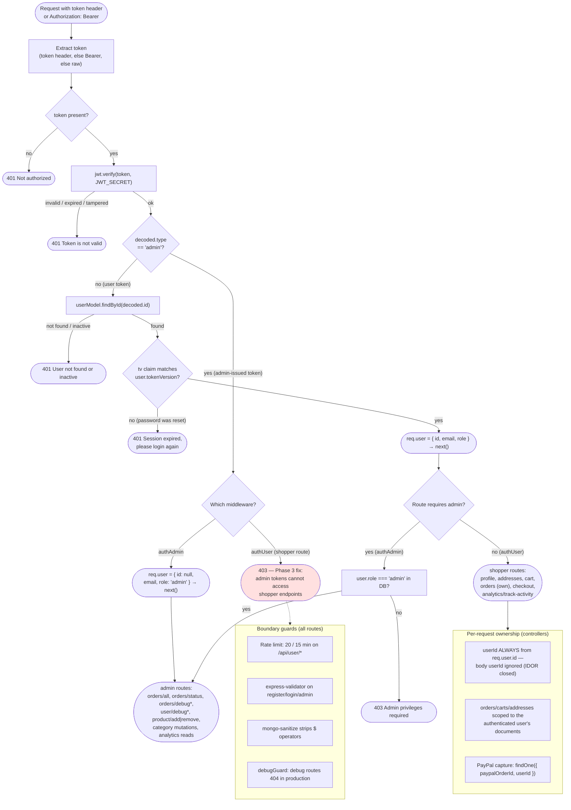

# Authentication & Authorization Flow — NovaCart

**Authority:** verified against `backend/middleware/auth.js`, `backend/controllers/userController.js`, and all route files on 2026-10-26 (post Phase 3 fix).

---

## 1. Token issuance

| Flow | Endpoint | Credentials | Token payload | Expiry |
|---|---|---|---|---|
| Shopper login | `POST /api/user/login` | email + bcrypt password (DB) | `{ id, tv: <tokenVersion> }` | 7 days |
| Shopper registration | `POST /api/user/register` | name/email/password (validated) | `{ id, tv }` | 7 days |
| Admin login | `POST /api/user/admin` | `ADMIN_EMAIL` / `ADMIN_PASSWORD` (environment — admins are not DB users) | `{ email, role: 'admin', type: 'admin' }` | 1 day |

Additional protections (verified): account lockout after 5 failed logins for 2 hours (`loginAttempts`/`lockUntil`); generic "Invalid credentials" responses; password policy (≥8 chars, upper/lower/digit/special) enforced by validator, controller, and schema pre-save hook; bcrypt salt rounds 12; password reset via emailed hashed token (1 h expiry) that bumps `tokenVersion` (AF-2 — invalidates every existing session).

## 2. Authentication and authorization flow (diagram 4)

\* debug routes additionally pass through `middleware/debugGuard.js` first: in `NODE_ENV=production` they answer 404 for everyone (existence hidden) unless `ENABLE_DEBUG_ENDPOINTS=true`.

## 3. Verified authorization matrix (regression-pinned)

The complete matrix is enforced by `__tests__/adminAuthorization.spec.js`, `__tests__/shopperAdminTokenBoundary.spec.js`, `__tests__/authorizationIdorAttacks.spec.js`, `__tests__/authenticationAttacks.spec.js`, and `__tests__/cartCategoryAddressAuthorization.spec.js`:

| Caller \ Resource | Shopper endpoints (profile, cart, own orders, checkout, track-activity) | Admin endpoints (orders/all, status, product/category mutations, analytics) | Debug endpoints (non-prod) |
|---|---|---|---|
| No token | 401 | 401 | 401 (404 in production — guard runs first) |
| Shopper token | ✅ 200 (own data only) | 403 | 403 |
| Admin token (`type: 'admin'`) | **403** (Phase 3 fix) | ✅ 200 | ✅ 200 |
| DB user with `role: 'admin'` via user login | ✅ 200 (own shopper data) | ✅ 200 (authAdmin verifies DB role) | ✅ 200 |
| Expired / tampered / wrong-secret token | 401 | 401 | 401 |
| Token with escalated `role` claim but user DB role `user` | ✅ own data (shopper path) | 403 (DB role check) | 403 |
| Admin token with `type` claim stripped | 401 (no user id) | 403 (not an admin-type token, no id) | 403 |

## 4. Socket.IO authentication (realtime channel)

The Socket.IO handshake runs its own JWT verification (same `JWT_SECRET`): admin-type tokens join `admin_room` with `userId = null`; user tokens require an existing, active DB user and join `user_<id>`. Admin-only room operations (`admin_join_order`) are gated on `socket.userRole === 'admin'` server-side.

## 5. Password reset consumption (AF-1/AF-2 chain, verified by tests)

1. `POST /api/user/forgot-password` always answers 200 with a non-committal message (no user enumeration); a hashed token (sha256) with 1 h expiry is stored only when the user exists.
2. `POST /api/user/reset-password` requires the raw token; lookups match the hash and the expiry window; the new password is re-validated and re-hashed; `tokenVersion` is bumped (all prior sessions 401 from then on); login attempts are reset; the token is cleared.
3. Reset tokens are single-use (cleared on success) and cleared again if the email send fails.
