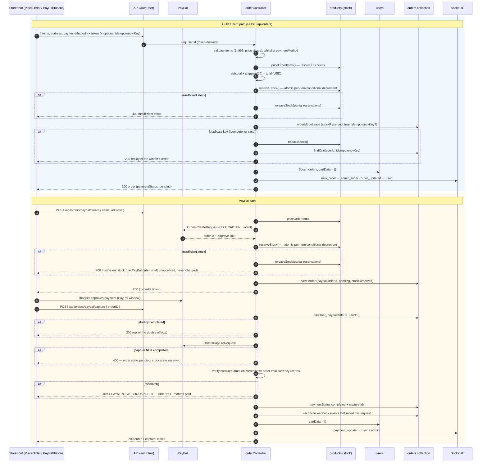
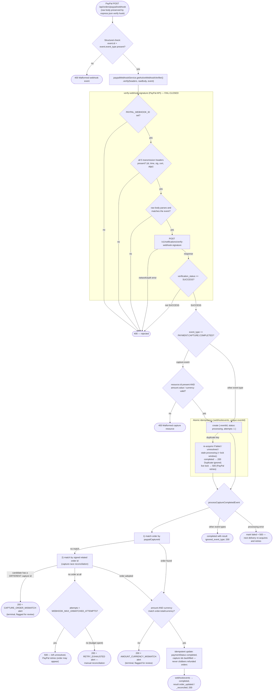

# Checkout & Payment Flow — NovaCart

**Authority:** verified against `backend/controllers/orderController.js`, `backend/services/reservationService.js` and `backend/services/paypalWebhookService.js` on 2026-10-26 (after the exactly-once restoration pass). This document describes **exactly** what the code does — including behaviors that do not exist (explicitly marked) so no reader assumes refund or inventory semantics that were never implemented.

---

## 1. Business rules (exact, from the implementation)

### Cart
- The cart is `user.cartData` on the user document: `{ productId → { color → quantity } }`. No stock or price checks occur on add/update — cart contents are advisory until checkout.
- Cart mutations derive `userId` exclusively from the verified token; a `userId` in the body is ignored (IDOR closed). Admin tokens are rejected (403).

### Checkout (all payment methods)
- **Prices are server-side only**: every item is resolved against `products` by id; the DB `price`, `name`, and first `image` are used; client-supplied prices are discarded (a supplied price that is not a positive finite number is rejected with 400 as a tamper signal).
- **Quantities**: integers 1–999 per item; unknown products are rejected (400) — no phantom orders.
- **Amounts**: `subtotal = Σ price × qty`, `shipping = 10` (fixed), `total = subtotal + shipping`, `currency = USD` (strict).
- **Stock reservation** happens at order creation (both the generic endpoint and PayPal create): the order is first inserted as a `stockReservation.status:'pending'` **draft**, then each item is decremented atomically via `findOneAndUpdate({ stockQuantity >= qty })` with a `<orderId>:<index>` debit marker in the same update, then the reservation is committed (`stockReserved:true`). If any item cannot be reserved, the debited lines are credited back, the draft is removed and the order is rejected with 400. A crash at any step leaves a recoverable draft that the sweep settles exactly once (`docs/10` §18.4).
- **Idempotency** (generic endpoint only): an optional `Idempotency-Key` header (≤ 200 chars) per checkout attempt. A replay returns the original order (`idempotentReplay: true`); the unique partial index `(userId, idempotencyKey)` decides races at save time — the loser releases its stock reservation and replays the winner's order. Absent key = legacy behavior (no dedup).
- **Payment methods**: `COD` and `Card` via `POST /api/orders`. `PayPal` is **not** accepted there — PayPal orders must be created via `/paypal/create` so they carry a `paypalOrderId` for webhook reconciliation.
- **`Card` semantics**: there is **no card gateway**. A `Card` order is created with `paymentStatus: 'pending'`; payment is arranged/collected off-band (the store settles before or on delivery). No card data is stored or transmitted.
- After a successful order: user's `orders` array is updated, **cart is cleared** (generic endpoint), analytics are recorded best-effort (failures never fail the order), and Socket.IO notifications are sent (new order → admin; order update → user).

### PayPal orders
- `POST /api/orders/paypal/create`: server-side pricing → PayPal `OrdersCreateRequest` (USD strict, itemized breakdown, US-normalized shipping address, `return_url`/`cancel_url` from `FRONTEND_URL`) → stock reservation → order saved with `paypalOrderId`, `paymentStatus: 'pending'`, `stockReserved: true`, `reservationExpiresAt` (TTL from `PAYPAL_RESERVATION_TTL_MS`).
- `POST /api/orders/paypal/capture`: the order must exist **for the authenticated user** (`{ paypalOrderId, userId }` — cross-user captures 404). If already `completed`, the order is replayed (no double effects). After `OrdersCaptureRequest`: the **captured amount and currency must equal** `order.total`/`order.currency` (cents-accurate) or the order is NOT marked paid (409 + alert). On success: `paymentStatus: 'completed'`, capture/transaction ids recorded, webhook events that arrived during the request are reconciled, cart cleared, realtime notifications sent.
- **Payment failure/cancel**: a non-`COMPLETED` capture status returns 400 (order stays `pending`, stock stays reserved). Abandoned PayPal orders **are** released automatically: `reservationService.releaseExpiredReservations()` runs every `RESERVATION_SWEEP_INTERVAL_MS` (default 5 min) and at boot, cancels the order atomically and returns the stock through the durable restoration obligation.
- The frontend renders the PayPal buttons only when `VITE_PAYPAL_CLIENT_ID` is set; otherwise a "paypal-unconfigured" fallback is shown.

### Admin order management
- `PUT /api/orders/status` (authAdmin): status must be in the server-side whitelist (`Order Placed, Packing, Shipped, Out for delivery, Delivered, Cancelled`).
- Setting `Cancelled` claims the release atomically (`stockReserved: true → false` **and** `inventoryRestoration.status:'pending'` in the same write), then credits each line back with an exactly-once product ledger (`restorationCredits`, one atomic `findOneAndUpdate`). A failed credit stays owed and is retried at boot/every sweep; legacy orders without the flag never restore (cannot inflate stock).
- Every status change emits `order_updated` to the order room, the user, and the admin room.

### What deliberately does NOT exist (do not assume)
- **No partial captures, no multi-currency** (USD only), **no online card gateway** (`Card` is a recorded intent), **no invoice emails** on purchase.
- Refunds **do** exist as an admin-only full-refund API (`POST /api/orders/refund`) with `refundStatus` reconciliation — they are not a customer-facing or partial-refund flow (`docs/09` §5.1).

---

## 2. Checkout and payment sequence diagram (diagram 5)

---

## 3. PayPal webhook verification flow (diagram 6)

**Concurrency & ordering guarantees (verified)**

- One successful payment can never fulfill twice: both the capture endpoint and the webhook path write the same idempotent state (`paymentStatus: 'completed'` + capture ids) and neither decrements stock (stock is reserved once, at order creation).
- Out-of-order events (webhook before the capture endpoint's DB write) are handled by the related-order-id reconciliation path and the capture endpoint's post-write sweep of `unresolved`/`failed` webhook records.
- Duplicate deliveries are acknowledged only when the event record is `completed`; interrupted (`failed`, stale `processing`) or `unresolved` deliveries are re-processed safely.
- Invalid signatures never touch the database (fail-closed before acquisition).
