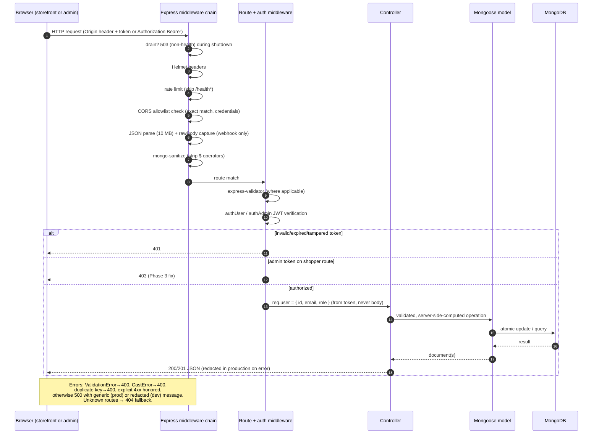

# Component Diagram & Frontend–Backend Request Flow

**Authority:** verified against source on 2026-10-26. Companion to `ARCHITECTURE_AUDIT.md`.

---

## 1. Complete application component diagram

```mermaid
flowchart TB
    subgraph FE["frontend/ — Storefront React PWA (React 18 + Vite)"]
        FEPAGES["pages/ (Home, Collection, Product,<br/>Cart, PlaceOrder, Orders, Login,<br/>ResetPassword, Profile, …)"]
        FECOMP["components/ (NavBar, ProductItems,<br/>AddressBook, PayPalPayment, PWA*)"]
        FECTX["context/ShopContext + hooks/<br/>(useAuth, useCart, useProducts,<br/>useCategories, useWebSocket)"]
        FEPAGES --> FECTX
        FECOMP --> FECTX
    end

    subgraph AD["admin/ — React Admin Console (React 19 + Vite)"]
        ADPAGES["pages/ (dashboard, orders, add, list,<br/>salesAnalytics, productAnalytics,<br/>userAnalytics, searchAnalytics)"]
        ADCFG["config.ts (backendUrl)"]
        ADPAGES --> ADCFG
    end

    subgraph BE["backend/ — Express REST API + Socket.IO"]
        direction TB
        subgraph mw["Middleware chain (order matters)"]
            DRAIN["Drain flag (503 while shutting down)"]
            HELMET["Helmet (CSP, headers)"]
            RATE["Rate limiting (global 1000/15m;<br/>auth routes 20/15m; health exempt)"]
            CORS["CORS allowlist<br/>(config/allowedOrigins.js)"]
            BODY["express.json (10 MB, rawBody capture<br/>for webhook path) + urlencoded"]
            SAN["express-mongo-sanitize"]
            AUTHMW["middleware/auth.js — authUser / authAdmin"]
            VAL["middleware/validation.js — express-validator"]
            MULT["middleware/multer.js — disk staging,<br/>image whitelist, 5 MB / 4 files"]
            DBG["middleware/debugGuard.js —<br/>production 404 for debug routes"]
        end

        subgraph routes["routes/"]
            R_USER["userRoute"]
            R_PROD["productRoute"]
            R_CART["cartRoute"]
            R_ADDR["addressRoute"]
            R_ORDER["orderRoute"]
            R_CAT["categoryRoute"]
            R_ANL["analyticsRoute"]
        end

        subgraph ctl["controllers/"]
            C_USER["userController"]
            C_PROD["productController"]
            C_CART["cartController"]
            C_ADDR["addressController"]
            C_ORDER["orderController"]
            C_CAT["categoryController"]
            C_ANL["analyticsController"]
        end

        subgraph svc["services/"]
            SOCK["socketService (Socket.IO, JWT handshake)"]
            PPW["paypalWebhookService<br/>(verify-webhook-signature, fail-closed)"]
            MAIL["emailService (nodemailer)"]
        end

        subgraph cfg["config/"]
            MONGOCFG["mongodb.js (URI resolver,<br/>connect + ping verify)"]
            PPENV["paypalEnv.js (sandbox/live switch)"]
            STARTVAL["startupValidation.js (boot guardrails)"]
            ORIGINS["allowedOrigins.js"]
            CLD["cloudinary.js"]
        end

        subgraph mdl["models/ (Mongoose)"]
            M_USER[("userModel<br/>users")]
            M_PROD[("productModel<br/>products")]
            M_CAT[("categoryModel<br/>categories")]
            M_ORDER[("orderModel<br/>orders")]
            M_ADDR[("addressModel<br/>addresses (standalone)")]
            M_ANL[("analyticsModel<br/>useractivities,<br/>productperformances,<br/>searchanalytics")]
            M_WH[("webhookEventModel<br/>webhookevents")]
        end

        UTIL["utils/redact.js · utils/shutdownManager.js"]
        HEALTH["GET /health/live · /health/ready · /health"]
    end

    subgraph EXT["External"]
        PP["PayPal API"]
        CLD2["Cloudinary"]
        SMTP["SMTP"]
        MONGODB[("MongoDB — e-commerce db")]
    end

    DRAIN --> HELMET --> RATE --> CORS --> BODY --> SAN --> routes
    routes --> AUTHMW
    routes --> VAL
    routes --> MULT
    routes --> DBG
    AUTHMW --> ctl
    VAL --> ctl
    MULT --> ctl
    DBG --> ctl

    R_USER --> C_USER
    R_PROD --> C_PROD
    R_CART --> C_CART
    R_ADDR --> C_ADDR
    R_ORDER --> C_ORDER
    R_CAT --> C_CAT
    R_ANL --> C_ANL

    C_USER --> M_USER
    C_PROD --> M_PROD
    C_PROD --> M_ANL
    C_PROD --> CLD2
    C_CAT --> M_CAT
    C_CART --> M_USER
    C_ADDR --> M_ADDR
    C_ORDER --> M_ORDER
    C_ORDER --> M_USER
    C_ORDER --> M_PROD
    C_ORDER --> M_WH
    C_ORDER --> M_ANL
    C_ORDER --> SOCK
    C_ORDER --> PPW
    C_ORDER --> PP
    C_ANL --> M_ANL
    C_ANL --> M_ORDER
    C_ANL --> M_PROD
    C_ANL --> M_USER
    C_USER --> MAIL

    MONGOCFG --> MONGODB
    PPW --> PPENV
    C_ORDER --> PPENV
    SOCK --> ORIGINS
    CORS --> ORIGINS
    CLD --> CLD2
    MAIL --> SMTP
    UTIL --> ctl
```

**Boundary notes (verified)**

- `authUser` protects shopper endpoints and **rejects admin tokens (403)**; `authAdmin` protects admin endpoints (accepts env-issued admin tokens or DB users with `role: 'admin'`).
- `debugGuard` runs **before** `authAdmin` on the two debug routes so production probes get 404 (existence hidden).
- The webhook route is **unauthenticated by design** (PayPal server-to-server); trust is established by signature verification instead.
- The raw request body is captured only for `POST /api/orders/paypal/webhook` (signature is computed over the exact bytes).

---

## 2. Frontend–backend request flow

**Representative request inventory (verified from the route files)**

| Method & path | Auth | Controller |
|---|---|---|
| `POST /api/user/register`, `/login`, `/admin`, `/forgot-password`, `/reset-password` | public (+validator on register/login/admin) | userController |
| `GET/PUT /api/user/profile` | authUser | userController |
| `POST/GET/PUT/DELETE /api/user/addresses*` | authUser | userController (embedded subdocuments) |
| `GET /api/user/debug` | debugGuard + authAdmin; 404 in production | userController |
| `GET /api/product/list`, `POST /api/product/single` | public | productController |
| `POST /api/product/add` | authAdmin + multer + validator | productController → Cloudinary |
| `POST /api/product/remove` | authAdmin + validator | productController → Cloudinary destroy |
| `POST /api/cart/add|get|update|sync-local` | authUser (admin tokens 403) | cartController |
| `POST /api/address/save` | authUser | addressController (standalone collection) |
| `POST /api/orders` | authUser | orderController (COD/Card) |
| `POST /api/orders/paypal/create`, `/paypal/capture` | authUser | orderController ↔ PayPal |
| `POST /api/orders/paypal/webhook` | signature verification (fail-closed) | orderController |
| `POST /api/orders/userorders`, `GET /api/orders/user` | authUser | orderController |
| `PUT /api/orders/status` | authAdmin | orderController |
| `GET /api/orders/all` | authAdmin | orderController |
| `GET /api/orders/debug` | debugGuard + authAdmin; 404 in production | orderController |
| `GET /api/category/list` | public | categoryController |
| `POST/PUT/DELETE /api/category/*` | authAdmin | categoryController |
| `POST /api/analytics/track-activity` | authUser | analyticsController |
| `GET /api/analytics/*`, `POST /api/analytics/cleanup` | authAdmin | analyticsController |
| `GET /health/live`, `/health/ready`, `/health`, `/api/socket/status`, `/` | public | app.js inline |
