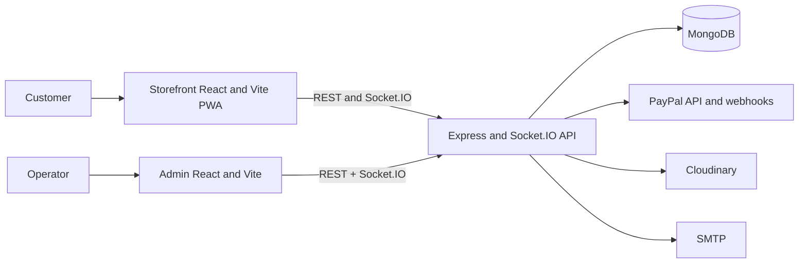
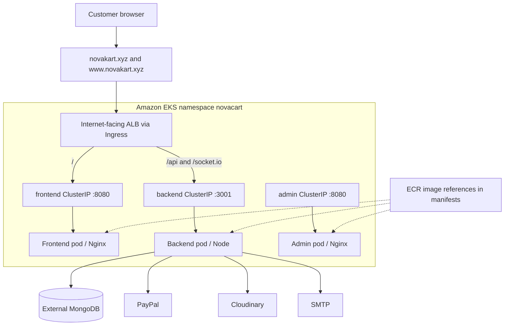
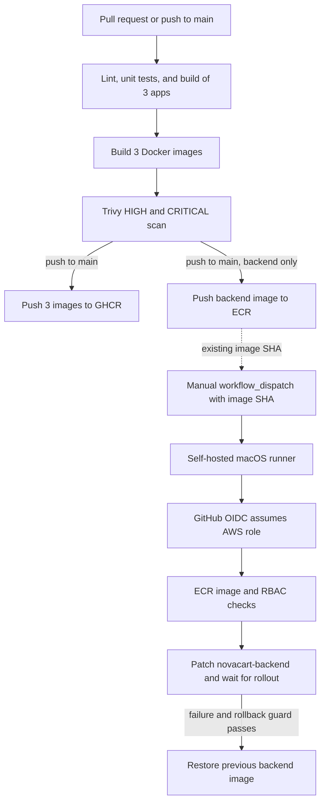

# NovaCart — Application and Deployment Architecture

**Application baseline:** 2026-10-26 system docs · **Infrastructure inspected:** 18–20 November 2026

This document records **files in the repository**. It is not a live AWS inventory. Sources: `frontend/`, `admin/`, `backend/`, `compose.yaml`, `k8s/`, `k8s/aws/`, `.github/workflows/`, `scripts/deploy-eks-backend.sh`, and `terraform/`.

The 2026-10-26 application diagrams in [SYSTEM_ARCHITECTURE.md](./SYSTEM_ARCHITECTURE.md) remain the detailed runtime picture. Where they still draw a “proposed DevOps” box, use this document for containers, Kubernetes, Terraform, and CI.

## 1. Logical application architecture

**Boundaries**

- Three applications build and ship separately. MongoDB is configured on the backend. The Kubernetes manifests do not run a database.
- Both the storefront and admin dashboard open authenticated Socket.IO connections. The storefront restores authorized order-room subscriptions after reconnect; the admin provider reconnects and the Orders page consumes `new_order` and `order_updated` events.
- PayPal is the integrated online payment method. A Card checkout records `paymentStatus: 'pending'`. It does not charge a card network.
- Webhook signature checks, idempotency, and stock debit/restore exist in backend code. A live signed PayPal sandbox round trip is a separate, still open checklist: [../devops/08-PAYPAL-SANDBOX-VALIDATION-CHECKLIST.md](../devops/08-PAYPAL-SANDBOX-VALIDATION-CHECKLIST.md).
- Multi-replica Socket.IO needs Redis. The AWS manifests set one backend replica and do not deploy Redis. The local HPA and Redis manifests are a different, local set.

## 2. AWS deployment configuration (as committed)

**Limits of this diagram**

1. `k8s/aws/novacart-ingress.yaml` names only `novakart.xyz` and `www.novakart.xyz`. The admin Service and Deployment exist. The Ingress does not route `admin.novakart.xyz`. Local HTTPRoutes use `shop.novacart.localhost` and `admin.novacart.localhost` and are not this Ingress.
2. Each AWS Deployment sets `replicas: 1`. `k8s/backend-hpa.yaml` is a local manifest (minimum 1, maximum 3). Nothing in `k8s/aws/` applies that HPA.
3. The load balancer comes from Ingress annotations for the AWS Load Balancer Controller, not from an `aws_lb` Terraform resource.
4. `terraform/eks-cluster.tf` places `novacart-dev-eks` on two public subnets and enables both public and private API endpoints, with public CIDRs from `var.eks_admin_cidrs`. Review that before any apply. `terraform/ecr.tf` is marked configuration-only at the top of the file.
5. Dotted ECR arrows mean the AWS Deployment manifests reference ECR image URIs for all three apps. The CI workflow that pushes to ECR on `main` pushes the **backend** image. Frontend and admin GHCR publishes are separate from those pinned ECR tags.
6. DNS, certificate validity, pod health, and whether the cluster still exists were not checked while writing this page.

## 3. CI and deployment flow

Image publishing and the EKS rollout are different workflows. Manual dispatch also needs the self-hosted runner, the OIDC role, the cluster, and permission to patch `deployment/novacart-backend`. Rollback in `scripts/deploy-eks-backend.sh` is conditional: it skips when restoring the previous image would be unsafe, and a failed rollback does not promise the last good pod is still serving.

Other workflows do not change this picture. `novacart-eks-auth.yml` and `aws-oidc-test.yml` are manual identity checks. `novacart-worker-tests.yml` tests EC2 worker helper scripts. None of them roll out the storefront or admin.

## 4. Terraform layout

| Area | Files |
| --- | --- |
| VPC, routing, security groups | `terraform/main.tf`, `networking.tf`, `security-groups.tf` |
| EKS cluster, nodes, addons, IAM | `terraform/eks-*.tf` |
| ECR for backend, storefront, and admin | `terraform/ecr.tf` |
| GitHub OIDC and deploy IAM | `terraform/github-deploy-iam/`, `terraform/iam-bootstrap/` |
| Deployment-worker network and IAM | `terraform/eks-deployment-worker-*.tf` |

These files are configuration. They do not show that the resources survived a later destroy, or that a worker node is up.

## 5. Runtime mechanisms and what each one proves

| Mechanism | Where it is | What the file proves |
| --- | --- | --- |
| Backend health | `/health/live`, `/health/ready` in Compose and in backend probes | Probes are wired. Uptime is not measured here |
| Frontend and admin health | HTTP GET `/` inside the Nginx images | The container responds. It does not prove the public DNS name |
| Resource limits | AWS Deployments | CPU and memory requests and limits are set on each app container |
| JWT auth | `backend/middleware/auth.js` and [../08-SECURITY.md](../08-SECURITY.md) | Application auth. Not an external audit |
| PayPal webhook checks | Backend order/webhook code and the webhook specs | Logic and automated tests with mocks. Not a live signed event |
| Socket.IO reconnect | `frontend/src/hooks/useWebSocket.ts` | Shopper client restores room subscriptions after reconnect |
| Graceful shutdown | Backend process and Compose `stop_grace_period: 30s` | The process drains on SIGTERM within a budget |
| EKS rollback | `scripts/deploy-eks-backend.sh` | A guarded rollback attempt for the backend Deployment only |

## 6. Before calling the platform live

Collect dated output you are willing to show: `terraform plan`, `aws eks describe-cluster`, `kubectl get deployments,svc,ingress -n novacart`, `kubectl rollout status`, HTTPS checks for hosts that the Ingress actually names, CI logs, and a sandbox payment plus webhook receipt. Keep account credentials, tokens, and kubeconfig files out of the repository and out of the docs.
