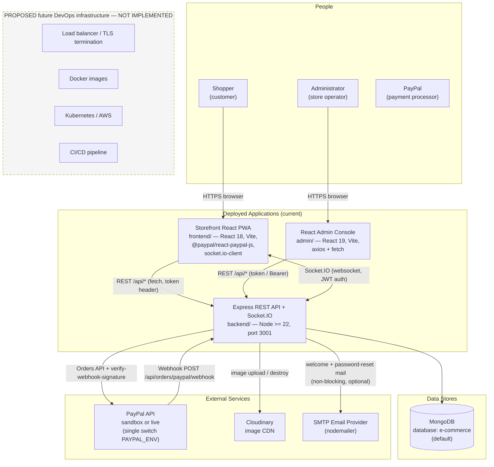
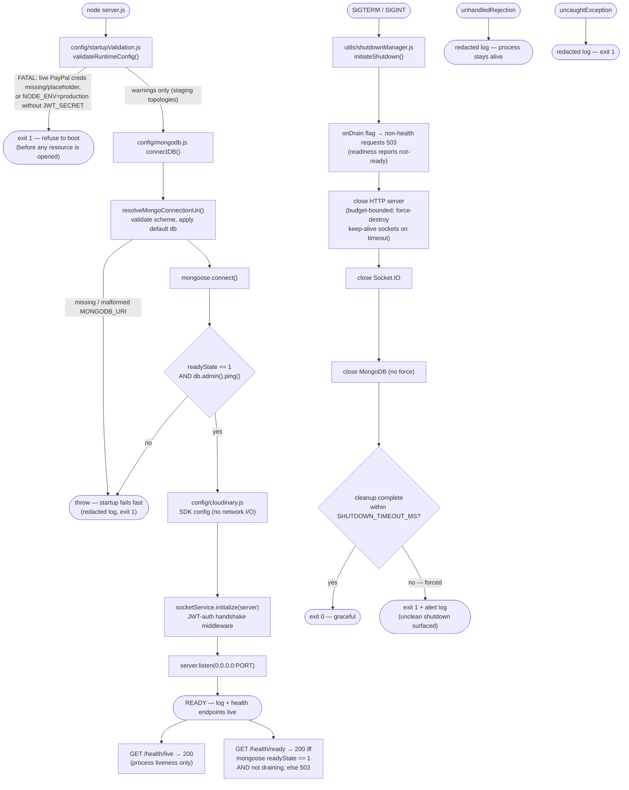
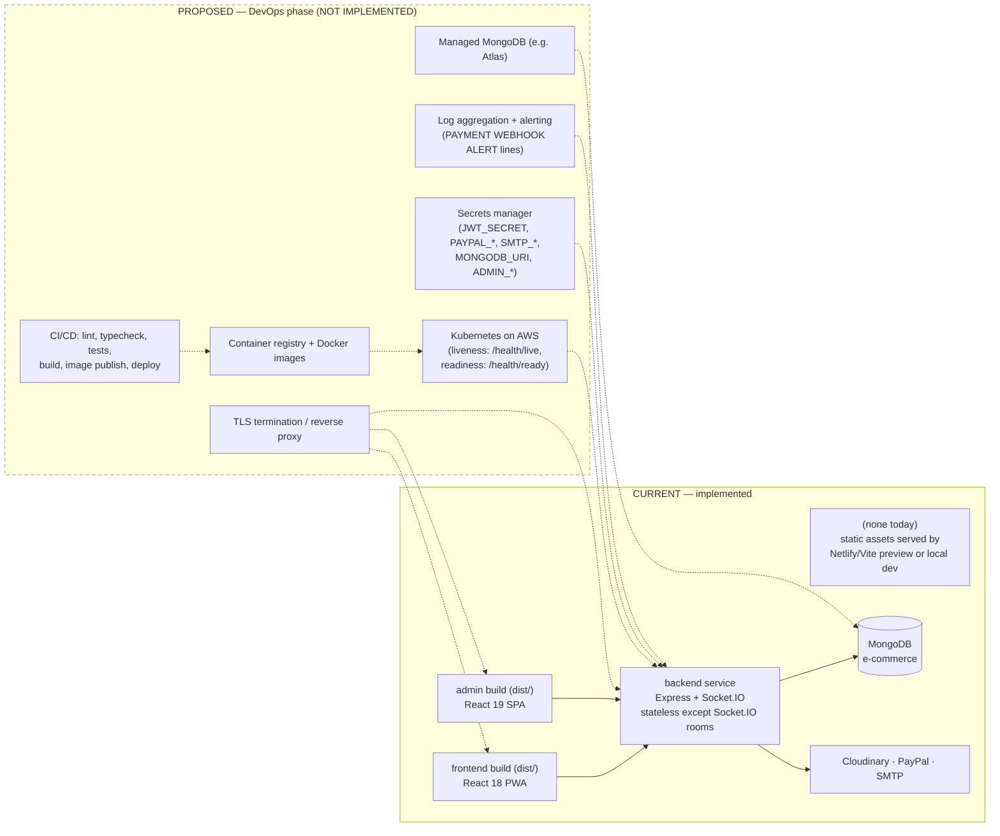
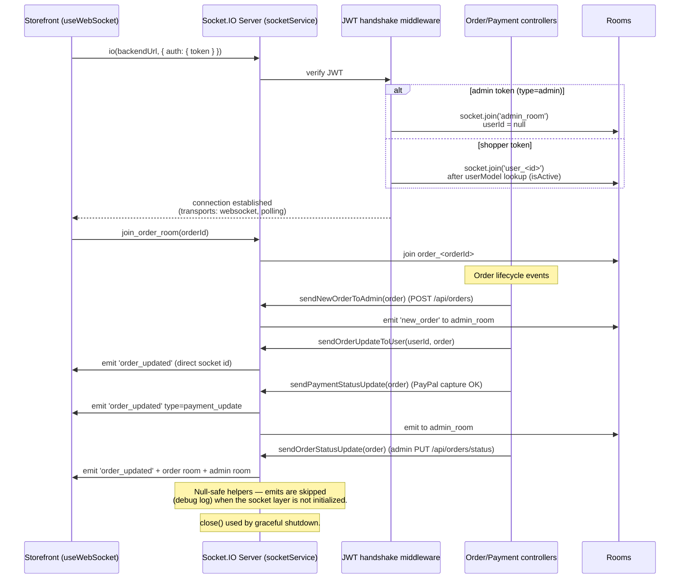

# System Architecture — NovaCart (AppleOnlineStore)

**Authority:** this document describes the system as implemented in source code on 2026-10-26 (post Phase 2–4 stabilization). Where future DevOps infrastructure is shown it is **explicitly marked PROPOSED** — nothing in this section exists in the repository today.

---

## 1. System context diagram

**Key facts verified from code**

- The storefront is a PWA (`vite-plugin-pwa`, service worker, offline page); the admin console is a plain SPA.
- Only the **storefront** holds a Socket.IO connection; the admin console has no realtime client (see `ARCHITECTURE_AUDIT.md` §3.1).
- PayPal sandbox/live selection is centralized in `config/paypalEnv.js` — the capture flow and the webhook verifier can never target different PayPal environments.
- MongoDB database selection: complete `MONGODB_URI` used verbatim; bare host URI gets `MONGODB_DB` (default `e-commerce`) appended by `config/mongodb.js`.

---

## 2. Application startup and readiness flow

**Verification:** `npm run verify:startup` (backend) executes this exact path against an in-memory MongoDB and asserts: ready 200, default database selected, graceful SIGTERM exit 0, no credentials in the startup log.

---

## 3. Logical architecture for future DevOps implementation

The diagram below is the **current logical architecture** (solid) with the **proposed DevOps overlay** (dashed, red). The dashed elements do not exist yet; they are the contract the DevOps phase will implement.

**DevOps-relevant properties of the current service (verified)**

| Property | Value / behavior |
|---|---|
| Runtime | Node.js >= 22 (engines field), ESM (`"type": "module"`) |
| Listen | `0.0.0.0:$PORT` (default 3001) |
| Probes | `/health/live` (liveness), `/health/ready` (readiness, DB-aware), legacy `/health` |
| Shutdown | Drain flag → 503; bounded http → sockets → db close; exit code signals cleanliness |
| Config | Environment variables only (see `backend/.env.example`); fatal boot guardrails for live-payments and production-auth misconfiguration |
| State | Process is stateless; Socket.IO rooms re-form on reconnect; webhookevents collection provides cross-restart idempotency |
| Scaling note | Socket.IO is in-memory (no Redis adapter) — sticky sessions or an adapter will be required for multi-replica deployments (see `DEVOPS_BASELINE.md`) |
| Build | Backend: no build; frontend/admin: `tsc -b && vite build` |

---

## 4. Socket.IO order update flow (diagram 8 of the corrected set)

**Verified behaviors:** admin room joins are role-gated server-side; all emit helpers tolerate an uninitialized/closed socket layer so order flows never crash on realtime failures; the connected-users map backs `GET /api/socket/status`.
