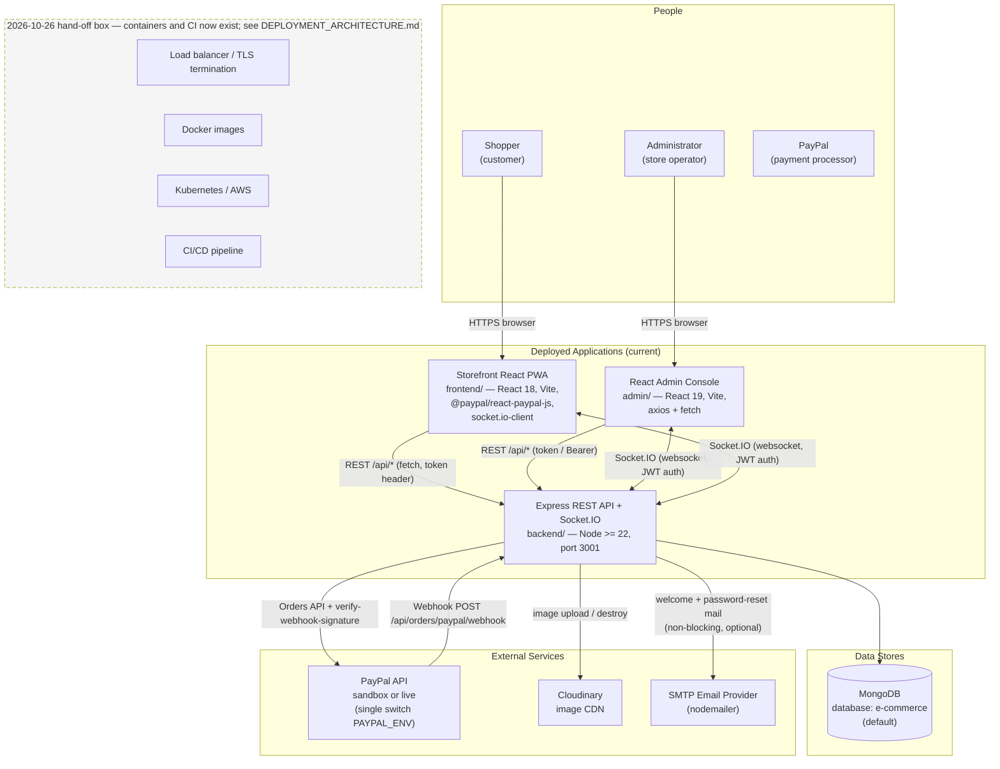
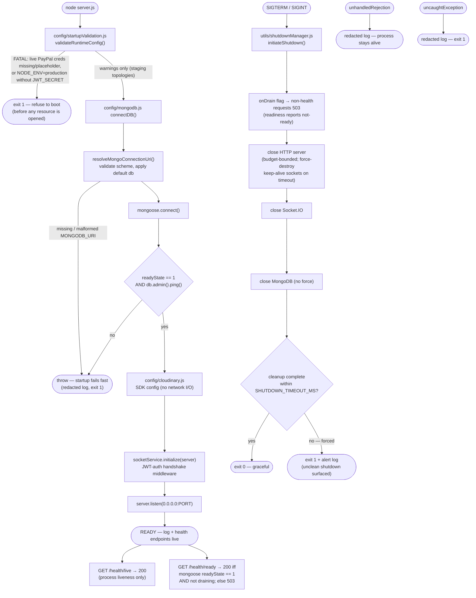
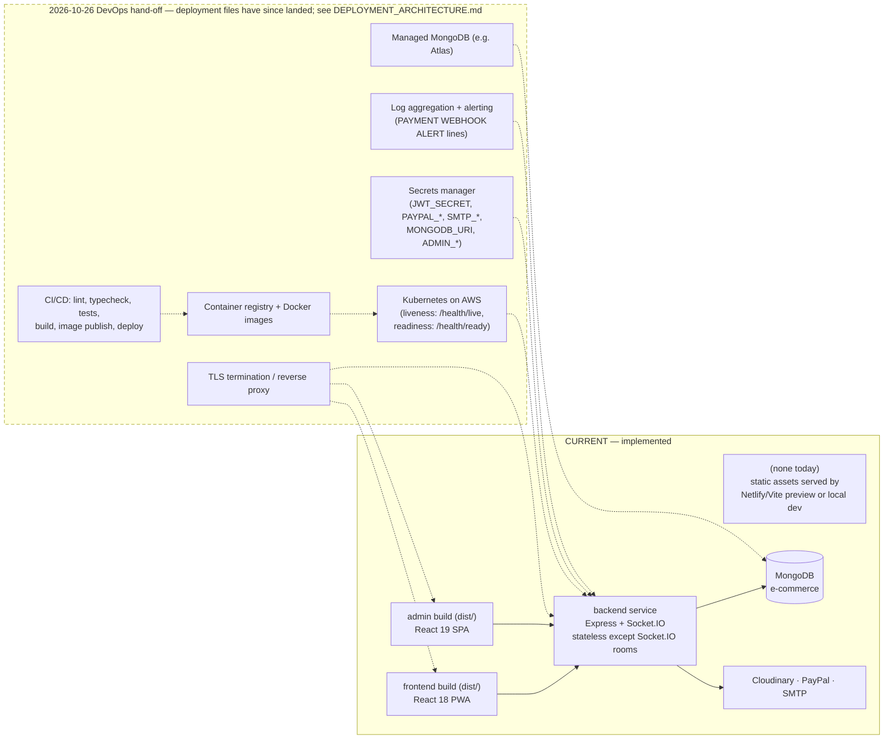
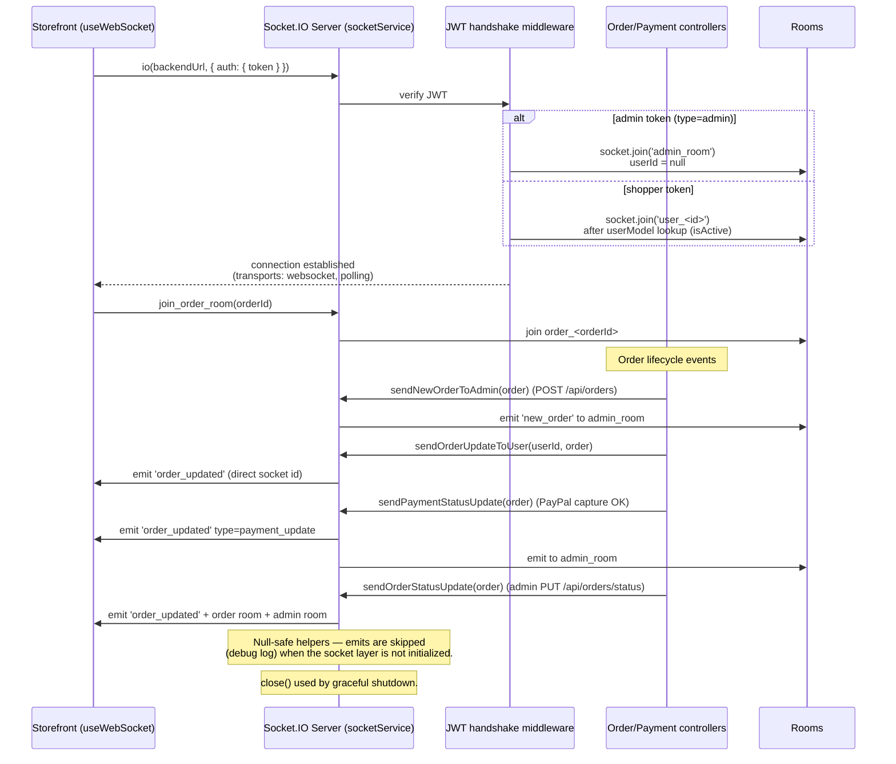

# System Architecture — NovaCart (AppleOnlineStore)

**Authority:** this document preserves the **application** baseline from 2026-10-26 (post Phase 2–4 stabilization). The dashed “proposed DevOps” boxes below are that day’s hand-off diagram.

**Infrastructure update (20 November 2026):** Dockerfiles, Compose, Kubernetes manifests, Terraform, and GitHub Actions are now in the repository. Read [DEPLOYMENT_ARCHITECTURE.md](./DEPLOYMENT_ARCHITECTURE.md) and [../06-DEPLOYMENT.md](../06-DEPLOYMENT.md) for the current deployment picture. Log aggregation and a live-cluster claim are still outside this page. The diagrams are kept so the 2026-10-26 baseline stays intact.

**Realtime update (20 November 2026):** the admin dashboard now also opens an authenticated Socket.IO connection and consumes order events. The storefront reconnect/room-resubscription flow and older diagrams below remain the 2026-10-26 baseline; see [DEPLOYMENT_ARCHITECTURE.md](./DEPLOYMENT_ARCHITECTURE.md) for the current client boundaries.

---

## 1. System context diagram

**Key facts verified from code**

- The storefront is a PWA (`vite-plugin-pwa`, service worker, offline page); the admin console is a plain SPA.
- The storefront and admin dashboard both hold authenticated Socket.IO connections. The admin connection and Orders-page event handling were added after the 2026-10-26 audit; its §3.1 finding is historical.
- PayPal sandbox/live selection is centralized in `config/paypalEnv.js` — the capture flow and the webhook verifier can never target different PayPal environments.
- MongoDB database selection: complete `MONGODB_URI` used verbatim; bare host URI gets `MONGODB_DB` (default `e-commerce`) appended by `config/mongodb.js`.

---

## 2. Application startup and readiness flow

**Verification:** `npm run verify:startup` (backend) executes this exact path against an in-memory MongoDB and asserts: ready 200, default database selected, graceful SIGTERM exit 0, no credentials in the startup log.

---

## 3. Logical architecture (2026-10-26 snapshot)

The solid boxes are the application. The dashed box was the DevOps hand-off on 2026-10-26. Container images, a registry publish path, Kubernetes manifests, and CI workflows have since been added; log aggregation is still not in the repo. Current deployment limits are in [DEPLOYMENT_ARCHITECTURE.md](./DEPLOYMENT_ARCHITECTURE.md). This diagram is preserved as the snapshot, not redrawn.

**DevOps-relevant properties of the current service (verified)**

| Property | Value / behavior |
|---|---|
| Runtime | Node.js >= 22 (engines field), ESM (`"type": "module"`) |
| Listen | `0.0.0.0:$PORT` (default 3001) |
| Probes | `/health/live` (liveness), `/health/ready` (readiness, DB-aware), legacy `/health` |
| Shutdown | Drain flag → 503; bounded http → sockets → db close; exit code signals cleanliness |
| Config | Environment variables only (see `backend/.env.example`); fatal boot guardrails for live-payments and production-auth misconfiguration |
| State | Process is stateless; Socket.IO rooms re-form on reconnect; webhookevents collection provides cross-restart idempotency |
| Scaling note | Socket.IO is in-memory (no Redis adapter) — sticky sessions or an adapter will be required for multi-replica deployments (see `DEVOPS_BASELINE.md`) |
| Build | Backend: no build; frontend/admin: `tsc -b && vite build` |

---

## 4. Socket.IO order update flow (diagram 8 of the corrected set)

**Verified behaviors:** admin room joins are role-gated server-side; all emit helpers tolerate an uninitialized/closed socket layer so order flows never crash on realtime failures; the connected-users map backs `GET /api/socket/status`.
